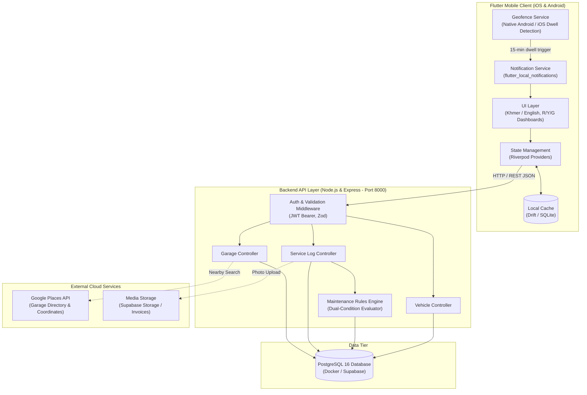
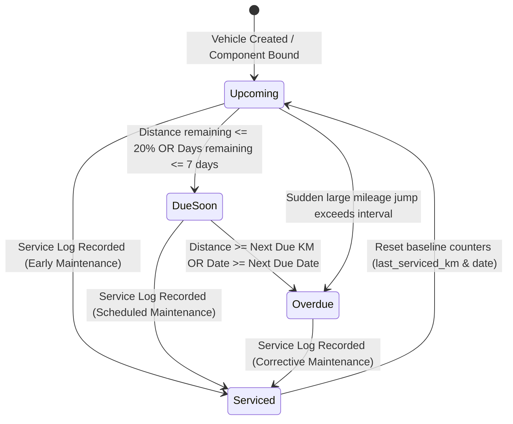

# Phase 3.2 — System Architecture Map

**Objective:** Show the parts of your system, what each one is responsible for, and how data moves between them. No application code yet; this is the plan.

**Status:** Submitted · **Last updated:** 2026-10-17

## Done When

- [x] The diagram shows every part you will build or run, plus every external service from Phase 3.1
- [x] The diagram displays on GitHub
- [x] Every box in the diagram has a row in the component table
- [x] One Must-Have flow is traced from start to finish, including what happens when a step fails

## 1. High-Level Component Map

## 2. Components

| Component | Responsibility | Technology | Runs when | Talks to |
|---|---|---|---|---|
| **Mobile UI Layer** | Renders high-contrast Red / Yellow / Green maintenance cards, authentic Khmer slang tags, and forms. | Flutter (Dart v3.5) | Continuously while app is in foreground | State Management (Riverpod) |
| **Mobile Local Cache** | Provides instant offline reads, holds local garage pins, and queues pending service logs when offline. | Drift / SQLite v3 | On every local read/write transaction | Mobile UI, Backend API |
| **Geofence Dwell Service** | Monitors device proximity to known garages; triggers after 15+ minutes of continuous dwell within 50m. | Android WorkManager / iOS CoreLocation via Flutter service | Runs in background when location permission is granted | Local Notification Service |
| **Local Notification Service** | Dispatches overdue maintenance warnings and "At-Garage" service logging prompt notifications to notification tray. | `flutter_local_notifications` | On geofence trigger or scheduled daily interval evaluation | Mobile UI |
| **Backend REST API** | Validates incoming payloads, verifies JWT tokens, handles vehicle registration, and serves API routes on port 8000. | Node.js (v20) + Express.js (v4.19) + TypeScript | Always-on HTTP server listening on port 8000 | Mobile Client, PostgreSQL |
| **Maintenance Rules Engine** | Evaluates dual-condition triggers (mileage and calendar elapsed duration) against `model_component_configs`; calculates reminder status. | TypeScript Domain Service | Invoked upon odometer update, vehicle creation, or new service log | PostgreSQL |
| **PostgreSQL Database** | Persistent relational storage for users, vehicles, model configs, components, service logs, and pinned garages. | PostgreSQL v16 (via Docker) | Always-on relational database daemon | Backend REST API |
| **Google Places API** | Pre-seeds verified motorcycle and auto repair shops across Phnom Penh and provides autocomplete search. | Google Cloud Platform REST API | Invoked on-demand when user searches or refreshes garage list | Backend Garage Controller |

### Secrets & Database Access

All production secrets (PostgreSQL database credentials, JWT secret keys, and Google Places API keys) reside strictly in a root `.env` file that is git-ignored and never committed to version control; an `.env.example` file is provided with sanitized placeholders. Only the backend Node.js Express service running inside the Docker network can connect directly to PostgreSQL. The mobile Flutter client communicates exclusively through authenticated HTTP REST requests over `/api/v1` using `Authorization: Bearer <token>` and cannot query the database directly.

## 3. Flow Trace

**Flow traced:** UJ-02 — Rapid 1-Tap Service Logging & Reminder Status Reset (Serving F-03 and F-04)

| Step | Where | What happens |
|---|---|---|
| 1 | Client App (UI) | Davy taps "+ កត់ត្រាការជួសជុល (Log Service)", selects preset tag "ប្រេងម៉ាស៊ីន (Engine Oil)", enters current odometer `13,500` km, cost `$5.00`, and taps "រក្សាទុក (Save)". |
| 2 | Client App (Network Layer) | Flutter client compiles JSON payload and sends `POST /api/v1/vehicles/:vehicleId/services` with header `Authorization: Bearer <jwt_token>`. |
| 3 | Backend API (Auth & Validation) | Auth middleware validates JWT token and verifies that the `vehicleId` belongs to Davy. Zod schema validates that odometer is greater than previous reading (`12,450` km) and cost is non-negative. *(If invalid, returns 400 Validation Error or 403 Forbidden; client displays red inline error).* |
| 4 | Backend API & Database | Controller initiates a database transaction: inserts an immutable row into `service_logs` with `cost_cents = 500`, `odometer_km = 13500`, and creates a link in `service_log_items` for the Engine Oil component. |
| 5 | Rules Engine | Maintenance Rules Engine executes trigger evaluation: finds the active `reminder_rules` row for Engine Oil on this vehicle, updates `last_serviced_odometer = 13500`, `last_serviced_date = CURRENT_DATE`, and resets `status = 'upcoming'`. Transaction commits. |
| 6 | Client App (UI Update) | API responds with `201 Created` and updated vehicle health summary. Client updates local Drift cache, switches the Engine Oil card from Yellow/Red to Green (`1,500 km remaining`), and displays a Khmer confirmation snackbar: *"បានរក្សាទុកការជួសជុលដោយជោគជ័យ (Service saved successfully)"*. |

## 4. State Transition Flowchart (Reminder Lifecycle State Machine)

