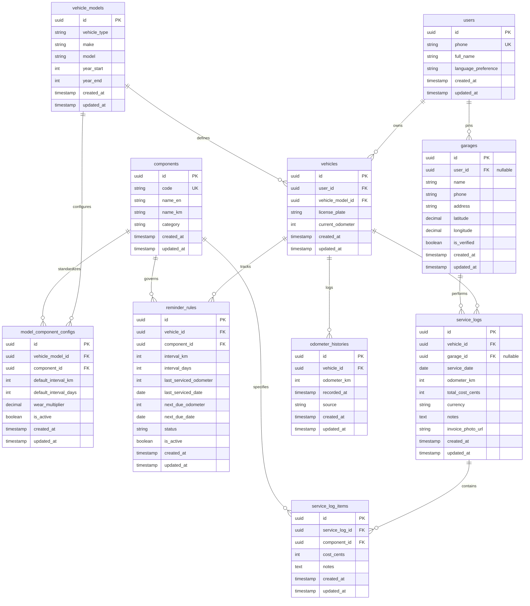

# Phase 3.3 — Database ERD

**Objective:** Design the data model your features need: every table, column, constraint and relationship, decided before any migration is written.

**Status:** Submitted · **Last updated:** 2026-10-17

## Done When

- [x] The ERD covers every Must-Have feature and journey, and renders on GitHub
- [x] Every table has a primary key and created/updated timestamps
- [x] Every foreign key has an on-delete rule in the data dictionary
- [x] No money columns use a floating-point type

## 1. Conventions

- Table names are plural and in snake_case (e.g. `service_logs`).
- Every table has a primary key `id` (UUID), plus `created_at` and `updated_at`.
- Money is stored strictly as an integer in the smallest unit (`total_cost_cents` for USD, or whole integers for KHR), never as a float.
- Foreign keys are named `<entity>_id`, indexed, and specify explicit `ON DELETE` referential integrity rules.

## 2. Entity Relationship Diagram

## 3. Data Dictionary

### Table: users

| Column | Data type | Constraints | Nullable | Description |
|---|---|---|---|---|
| id | uuid | PRIMARY KEY, DEFAULT gen_random_uuid() | No | Unique user identifier |
| phone | varchar(20) | UNIQUE | No | Cambodian phone number (e.g. +85512888999) |
| full_name | varchar(100) | | No | User's full name |
| language_preference | varchar(10) | DEFAULT 'km', CHECK in ('km', 'en') | No | Preferred app language |
| created_at | timestamp with time zone | DEFAULT now() | No | When user account was created |
| updated_at | timestamp with time zone | DEFAULT now() | No | When user profile was last updated |

---

### Table: vehicle_models

| Column | Data type | Constraints | Nullable | Description |
|---|---|---|---|---|
| id | uuid | PRIMARY KEY, DEFAULT gen_random_uuid() | No | Unique model identifier |
| vehicle_type | varchar(20) | CHECK in ('scooter', 'motorcycle', 'car') | No | Classification of vehicle |
| make | varchar(50) | | No | Manufacturer (e.g., Honda, Toyota) |
| model | varchar(50) | | No | Model name (e.g., Scoopy, Dream 125, Prius) |
| year_start | integer | CHECK (year_start >= 1990) | No | Production start year |
| year_end | integer | | Yes | Production end year (null if ongoing) |
| created_at | timestamp with time zone | DEFAULT now() | No | Creation timestamp |
| updated_at | timestamp with time zone | DEFAULT now() | No | Last update timestamp |

---

### Table: components

| Column | Data type | Constraints | Nullable | Description |
|---|---|---|---|---|
| id | uuid | PRIMARY KEY, DEFAULT gen_random_uuid() | No | Unique component identifier |
| code | varchar(50) | UNIQUE | No | System code (e.g. ENGINE_OIL, DRIVE_BELT) |
| name_en | varchar(100) | | No | English name (e.g. Engine Oil) |
| name_km | varchar(100) | | No | Authentic Khmer mechanic slang (e.g. ប្រេងម៉ាស៊ីន) |
| category | varchar(50) | CHECK in ('lubricant', 'transmission', 'ignition', 'braking', 'cooling') | No | Component domain category |
| created_at | timestamp with time zone | DEFAULT now() | No | Creation timestamp |
| updated_at | timestamp with time zone | DEFAULT now() | No | Last update timestamp |

---

### Table: model_component_configs

| Column | Data type | Constraints | Nullable | Description |
|---|---|---|---|---|
| id | uuid | PRIMARY KEY, DEFAULT gen_random_uuid() | No | Unique configuration identifier |
| vehicle_model_id | uuid | FK → vehicle_models.id ON DELETE CASCADE | No | Model being configured |
| component_id | uuid | FK → components.id ON DELETE CASCADE | No | Component being configured |
| default_interval_km | integer | CHECK (default_interval_km > 0) | No | Base distance trigger (e.g. 1500 km for Scoopy oil) |
| default_interval_days | integer | CHECK (default_interval_days > 0) | No | Base calendar trigger (e.g. 90 days) |
| wear_multiplier | numeric(3,2) | DEFAULT 1.00, CHECK (wear_multiplier > 0) | No | Configurable wear multiplier for harsh conditions |
| is_active | boolean | DEFAULT true | No | Whether configuration rule is active |
| created_at | timestamp with time zone | DEFAULT now() | No | Creation timestamp |
| updated_at | timestamp with time zone | DEFAULT now() | No | Last update timestamp |

---

### Table: vehicles

| Column | Data type | Constraints | Nullable | Description |
|---|---|---|---|---|
| id | uuid | PRIMARY KEY, DEFAULT gen_random_uuid() | No | Unique vehicle identifier |
| user_id | uuid | FK → users.id ON DELETE CASCADE | No | Owning user |
| vehicle_model_id | uuid | FK → vehicle_models.id ON DELETE RESTRICT | No | Reference to vehicle model |
| license_plate | varchar(20) | | Yes | Cambodian license plate (e.g. 1JJ-8888) |
| current_odometer | integer | DEFAULT 0, CHECK (current_odometer >= 0) | No | Latest recorded cumulative odometer in km |
| created_at | timestamp with time zone | DEFAULT now() | No | Creation timestamp |
| updated_at | timestamp with time zone | DEFAULT now() | No | Last update timestamp |

---

### Table: reminder_rules

| Column | Data type | Constraints | Nullable | Description |
|---|---|---|---|---|
| id | uuid | PRIMARY KEY, DEFAULT gen_random_uuid() | No | Unique reminder rule identifier |
| vehicle_id | uuid | FK → vehicles.id ON DELETE CASCADE | No | Target vehicle |
| component_id | uuid | FK → components.id ON DELETE RESTRICT | No | Monitored component |
| interval_km | integer | CHECK (interval_km > 0) | No | Effective distance trigger |
| interval_days | integer | CHECK (interval_days > 0) | No | Effective time trigger |
| last_serviced_odometer | integer | DEFAULT 0 | No | Odometer at last service event |
| last_serviced_date | date | DEFAULT CURRENT_DATE | No | Date when component was last serviced |
| next_due_odometer | integer | CHECK (next_due_odometer >= last_serviced_odometer) | No | Calculated target due km |
| next_due_date | date | | No | Calculated target due date |
| status | varchar(20) | CHECK in ('upcoming', 'due_soon', 'overdue', 'serviced') | No | Current R/Y/G health state |
| is_active | boolean | DEFAULT true | No | Active tracking flag |
| created_at | timestamp with time zone | DEFAULT now() | No | Creation timestamp |
| updated_at | timestamp with time zone | DEFAULT now() | No | Last update timestamp |

---

### Table: garages

| Column | Data type | Constraints | Nullable | Description |
|---|---|---|---|---|
| id | uuid | PRIMARY KEY, DEFAULT gen_random_uuid() | No | Unique garage identifier |
| user_id | uuid | FK → users.id ON DELETE SET NULL | Yes | User who pinned this garage (null if pre-seeded) |
| name | varchar(150) | | No | Shop name (e.g. ជាង រិទ្ធ ជួសជុលម៉ូតូ) |
| phone | varchar(20) | | Yes | Mechanic phone number |
| address | varchar(255) | | Yes | Street address or landmark description |
| latitude | numeric(10,7) | CHECK (latitude BETWEEN -90 AND 90) | No | WGS84 GPS latitude coordinate |
| longitude | numeric(10,7) | CHECK (longitude BETWEEN -180 AND 180) | No | WGS84 GPS longitude coordinate |
| is_verified | boolean | DEFAULT false | No | True if verified Google Places garage |
| created_at | timestamp with time zone | DEFAULT now() | No | Creation timestamp |
| updated_at | timestamp with time zone | DEFAULT now() | No | Last update timestamp |

---

### Table: service_logs

| Column | Data type | Constraints | Nullable | Description |
|---|---|---|---|---|
| id | uuid | PRIMARY KEY, DEFAULT gen_random_uuid() | No | Unique service log identifier |
| vehicle_id | uuid | FK → vehicles.id ON DELETE CASCADE | No | Vehicle that was serviced |
| garage_id | uuid | FK → garages.id ON DELETE SET NULL | Yes | Garage where service occurred |
| service_date | date | DEFAULT CURRENT_DATE | No | Date service was performed |
| odometer_km | integer | CHECK (odometer_km >= 0) | No | Odometer reading during service |
| total_cost_cents | integer | DEFAULT 0, CHECK (total_cost_cents >= 0) | No | Total cost in cents ($5.00 = 500) |
| currency | varchar(3) | DEFAULT 'USD', CHECK in ('USD', 'KHR') | No | Payment currency |
| notes | text | | Yes | Additional mechanic notes or remarks |
| invoice_photo_url | varchar(500) | | Yes | Image URL of receipt or oil label |
| created_at | timestamp with time zone | DEFAULT now() | No | Creation timestamp |
| updated_at | timestamp with time zone | DEFAULT now() | No | Last update timestamp |

---

### Table: service_log_items

| Column | Data type | Constraints | Nullable | Description |
|---|---|---|---|---|
| id | uuid | PRIMARY KEY, DEFAULT gen_random_uuid() | No | Unique line item identifier |
| service_log_id | uuid | FK → service_logs.id ON DELETE CASCADE | No | Parent service log |
| component_id | uuid | FK → components.id ON DELETE RESTRICT | No | Service item component |
| cost_cents | integer | DEFAULT 0, CHECK (cost_cents >= 0) | No | Component item cost in cents |
| notes | text | | Yes | Item specific notes (e.g. 10W-40 Synthetic) |
| created_at | timestamp with time zone | DEFAULT now() | No | Creation timestamp |
| updated_at | timestamp with time zone | DEFAULT now() | No | Last update timestamp |

---

### Table: odometer_histories

| Column | Data type | Constraints | Nullable | Description |
|---|---|---|---|---|
| id | uuid | PRIMARY KEY, DEFAULT gen_random_uuid() | No | Unique history entry identifier |
| vehicle_id | uuid | FK → vehicles.id ON DELETE CASCADE | No | Vehicle recorded |
| odometer_km | integer | CHECK (odometer_km >= 0) | No | Recorded odometer reading |
| recorded_at | timestamp with time zone | DEFAULT now() | No | Exact time when reading was captured |
| source | varchar(20) | CHECK in ('manual', 'service_log', 'garage_dwell') | No | Data capture source |
| created_at | timestamp with time zone | DEFAULT now() | No | Creation timestamp |
| updated_at | timestamp with time zone | DEFAULT now() | No | Last update timestamp |
